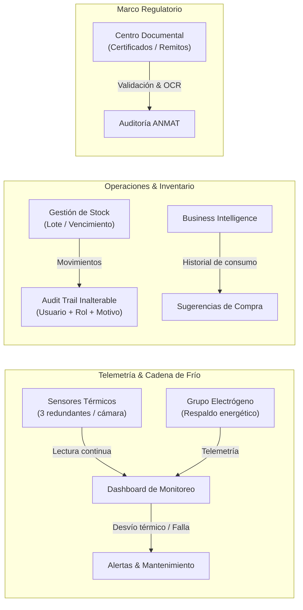

# Sistema de Gestión Logística Farmacéutica (FarmaTech)
### Prototipo Interactivo de Alta Fidelidad | 2026


---

## 📌 Descripción del Proyecto

Prototipo interactivo de aplicación web **multi-rol** para el monitoreo de cadena de frío, gestión de inventario y compliance documental en una empresa farmacéutica. 

El sistema fue diseñado y desarrollado aplicando conceptos de **Gobernanza de TI**, **Business Intelligence** e **Ingeniería de Requerimientos** sobre un caso de negocio real del sector salud, donde la precisión operativa y el cumplimiento de normativas de almacenamiento resultan críticos.

---

## 🚀 Capacidades y Módulos Principales

### 1. ❄️ Monitoreo Térmico & Telemetría IoT (Cadena de Frío)
* **Sensores Redundantes:** Supervisión en tiempo real de unidades de almacenamiento (cámaras frigoríficas y freezers) con lectura de 3 sensores térmicos por unidad para prevenir falsos positivos y asegurar continuidad operativa.
* **Detección de Anomalías:** Indicadores de estado visuales y alertas tempranas ante desvíos térmicos o sensores fuera de rango/defectuosos.
* **Infraestructura Crítica de Respaldo:** Monitor de estado de grupo electrógeno auxiliar (nivel de combustible, estado operativo y horas de funcionamiento acumuladas).
* **Gestión de Eventos y Mantenimiento:** Registro histórico de incidencias térmicas y emisión de solicitudes de mantenimiento preventivo y correctivo.

### 2. 📦 Gestión de Inventario & Trazabilidad por Lote
* **Control de Stock Especializado:** Segmentación por insumos críticos, vacunas y blisters.
* **Trazabilidad Integral:** Seguimiento estricto por número de lote, fecha de vencimiento y ubicación física en depósito.
* **Audit Trail Operativo:** Registro detallado de movimientos (ingresos, egresos, modificaciones y ajustes de stock) asociando usuario, rol, fecha/hora y motivo de operación.
* **Fichas Técnicas:** Visualización de especificaciones de materiales, proporciones e instrucciones seguras de manejo de fármacos.

### 3. 📑 Centro de Documentación & Compliance ANMAT
* **Conformidad Regulatoria:** Gestión centralizada de documentos legales, remitos y certificados sanitarios requeridos para auditorías de organismos regulatorios (ANMAT).
* **Extracción Inteligente de Datos:** Modelado de validación documental y extracción estructurada de datos críticos (lote, proveedor, elaboración y caducidad).
* **Workflow de Aprobación:** Estados auditables de aprobación y rechazo con registro de firmas y responsables.

### 4. 📊 Business Intelligence & Analítica Predictiva
* **Visualización de Tendencias:** Dashboards dinámicos interactivos para el análisis de rotación de productos y consumo histórico.
* **Sugerencias Automatizadas de Compra:** Módulo inteligente con priorización de órdenes de compra según criticidad y estimación de quiebre de stock.

---

## 🏗️ Arquitectura y Flujo Operativo



---

## 👥 Matriz de Roles y Permisos (RBAC)

La plataforma modela una arquitectura de **Control de Acceso Basado en Roles (RBAC)** con vistas y acciones diferenciadas:

| Rol | Alcance y Responsabilidades Principales |
| :--- | :--- |
| **Administrador IT** | Control total del sistema, configuración técnica de sensores, monitoreo de infraestructura y gobernanza de accesos. |
| **Jefe de Logística** | Supervisión global de la cadena de frío, visualización de métricas BI / tendencias de consumo y aprobación de solicitudes de compras. |
| **Operario de Depósito** | Ejecución de operaciones físicas de inventario (ingresos/egresos), consulta de fichas técnicas y reporte de incidencias en cámaras. |
| **Auditor** | Acceso en modo consulta (solo lectura) a registros históricos, auditoría de operaciones y repositorio documental ANMAT. |

---

## 🛠️ Stack Tecnológico

* **Core & Lenguaje:** [React 18](https://react.dev/) + [TypeScript](https://www.typescriptlang.org/)
* **Build Tool:** [Vite](https://vitejs.dev/)
* **Estilos y UI:** [Tailwind CSS v4](https://tailwindcss.com/) + Primitivas de [Radix UI](https://www.radix-ui.com/) + [Lucide React Icons](https://lucide.dev/)
* **Gráficos & Visualización:** [Recharts](https://recharts.org/)
* **Animaciones & Micro-interacciones:** [Motion](https://motion.dev/)
* **Enrutamiento:** [React Router](https://reactrouter.com/)

---

## 📂 Estructura del Proyecto

```text
src/
├── app/
│   ├── components/      # Componentes UI reutilizables, guards de ruta y layout
│   ├── context/         # Estado global (autenticación y permisos de roles)
│   ├── data/            # Mock datasets modelados bajo escenarios reales
│   ├── pages/           # Vistas principales:
│   │   ├── DashboardMonitoreo.tsx   # Control de sensores y cadena de frío
│   │   ├── GestionStock.tsx         # Inventario y trazabilidad por lote
│   │   ├── Documentacion.tsx        # Compliance y auditorías ANMAT
│   │   ├── TendenciasInventario.tsx # Analítica y proyecciones BI
│   │   └── Login.tsx                # Selector interactivo de roles
│   ├── routes.tsx       # Configuración de rutas y protección RBAC
│   └── types/           # Modelado de entidades y tipado estricto
└── main.tsx             # Punto de entrada de la aplicación
```

---

## 💻 Instalación y Ejecución Local

1. **Clonar el repositorio:**
   ```bash
   git clone https://github.com/santillan-nahuel/TP-IdS-farmatech-logistics-web.git
   cd TP-IdS-farmatech-logistics-web
   ```

2. **Instalar dependencias:**
   ```bash
   npm install
   ```

3. **Iniciar el servidor de desarrollo:**
   ```bash
   npm run dev
   ```

4. **Abrir en el navegador:**
   Ingresar a la URL provista por Vite (habitualmente `http://localhost:5173`).

---

## 🎯 Enfoque Profesional & Académico

Este desarrollo sintetiza la aplicación de buenas prácticas de ingeniería de software sobre el ciclo de vida del producto:
* **Levantamiento y validación de requerimientos** funcionales y no funcionales para la industria farmacéutica.
* **Gobernanza y trazabilidad:** Cumplimiento de registros inalterables y segregación de funciones.
* **Diseño centrado en el usuario (UX/UI):** Prototipo de alta fidelidad con feedback visual inmediato para operadores y auditores.
